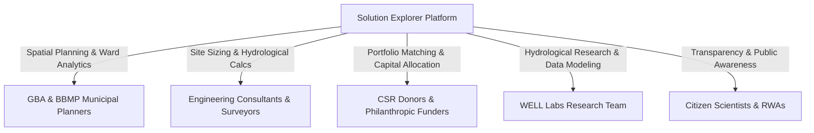
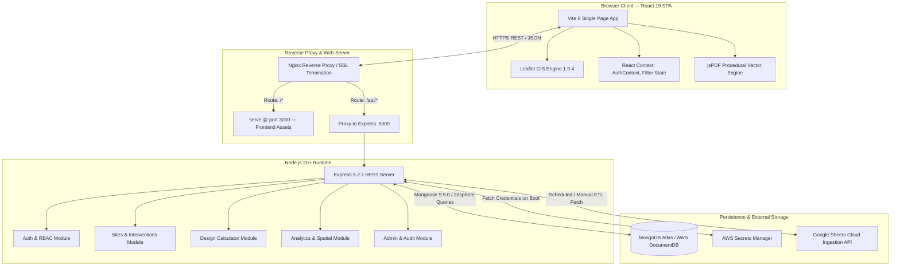
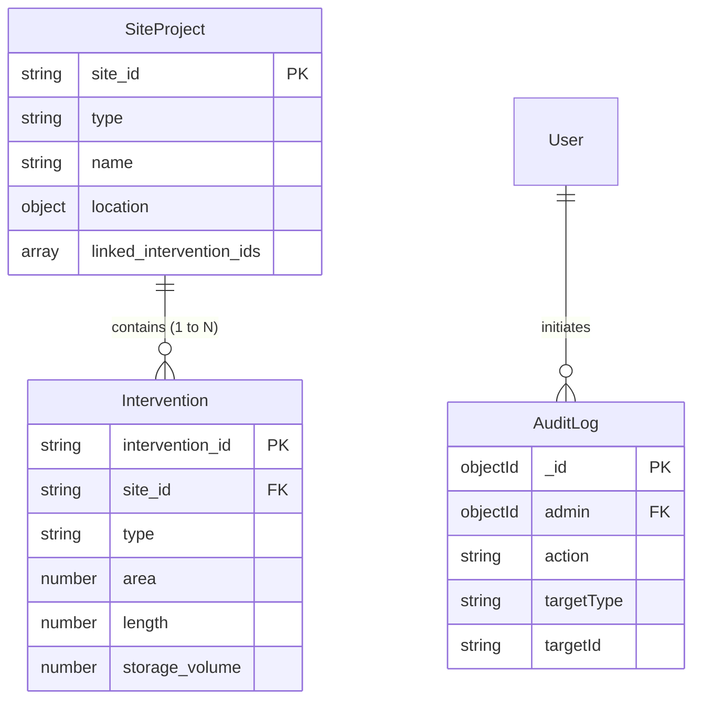
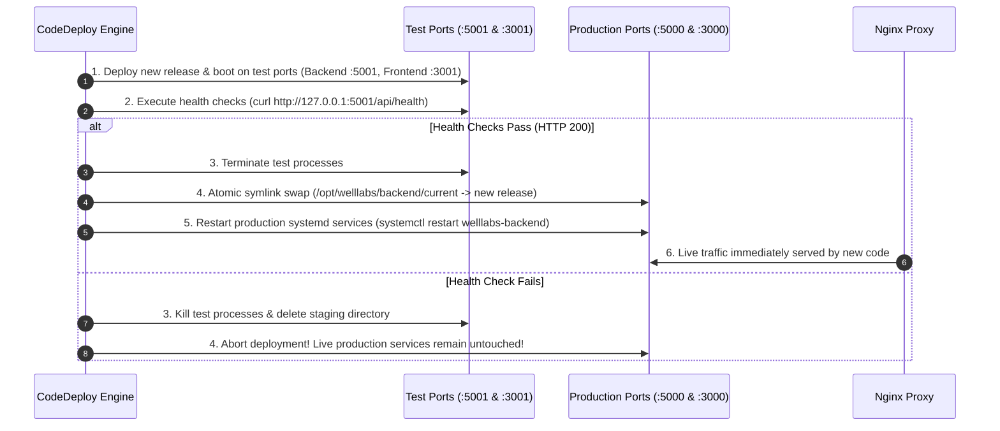

# Bengaluru Climate Solutions Explorer (Solution Explorer)
## Definitive System Architecture, Hydrological Modeling & Engineering Operations Manual

---

> **Document Status**: Production Reference Manual  
> **Target Audience**: Principal Software Engineers, GIS Architects, Hydrological Modelers, Municipal Planners (GBA / BBMP), and DevOps Leads  
> **Classification**: Technical & Operational Documentation  
> **Last Verified Release**: Node.js 20+ / Express 5.2.1 / React 19.2.5 / Vite 8.0.9 / Mongoose 9.5.0  

---

## Table of Contents

1. [Executive Overview & Municipal Context](#1-executive-overview--municipal-context)
   - 1.1 The Bengaluru Urban Hydrology Dilemma
   - 1.2 The Blue-Green-Grey (BGG) Engineering Philosophy
   - 1.3 System Mission & Stakeholder Matrix
2. [End-to-End System Architecture](#2-end-to-end-system-architecture)
   - 2.1 Architectural Topology
   - 2.2 Tech Stack Selection Rationale
   - 2.3 The Geospatial Coordinate Pipeline & Projection Quirks
3. [Database Architecture & Spatial Indexing](#3-database-architecture--spatial-indexing)
   - 3.1 MongoDB Spatial Engine & `2dsphere` Indexes
   - 3.2 Schema Specifications
     - 3.2.1 `SiteProject`
     - 3.2.2 `Intervention`
     - 3.2.3 `Well` (Groundwater & Water Quality)
     - 3.2.4 `Project` (Legacy & Municipal Interventions)
     - 3.2.5 `FloodHotspot`
     - 3.2.6 `User`
     - 3.2.7 `AuditLog` & `FailedLogin`
   - 3.3 Relational Linkage Model & Normalization Decisions
4. [Backend API Engine (Express 5.x)](#4-backend-api-engine-express-5x)
   - 4.1 Server Lifecycle & Startup Orchestration
   - 4.2 Middleware Pipeline: CORS, Proxies, Cookies & Rate Limiting
   - 4.3 REST Endpoint Reference
     - 4.3.1 Authentication & Profile (`/api/auth`)
     - 4.3.2 Admin Operations & Audit Telemetry (`/api/admin`)
     - 4.3.3 BGG Sites & Interventions (`/api/sites`)
     - 4.3.4 Hydrological Design Calculator (`/api/design-calculator`)
     - 4.3.5 Municipal Analytics & Spatial Summaries (`/api/analytics`)
     - 4.3.6 Flood Hotspots (`/api/flood-hotspots`)
5. [Frontend Architecture & State Machine (React 19 & Vite 8)](#5-frontend-architecture--state-machine-react-19--vite-8)
   - 5.1 Application Bootstrap & Route Routing Strategy
   - 5.2 Context Providers & Authentication State
   - 5.3 Core UI Views & Operational Modules
     - 5.3.1 `BggIntroduction` (`/home`): Climate Telemetry & Crisis Narrative
     - 5.3.2 `DataLayersView` (`/dashboard`): The GIS Map Engine
     - 5.3.3 `NewProjectsView` (`/newprojects`): BGG Project Workspace
     - 5.3.4 `FundAProjectModal`: CSR Capital Matching Wizard
     - 5.3.5 `DesignCalculator` (`/design-calculator`): Hydrological Runoff Engine
     - 5.3.6 `CaseStudies` & `BggGuidelines`: Knowledge Systems
     - 5.3.7 Admin Portal & Dynamic Path Obfuscation
6. [Hydrological Modeling & Technical Mathematics](#6-hydrological-modeling--technical-mathematics)
   - 6.1 Rational Method Adaptation for Bangalore Micro-Catchments
   - 6.2 Rainfall Intensity Return Periods & Recurrence Intervals
   - 6.3 Infiltration & Retention Calculations
7. [Procedural Vector Graphics: The jsPDF 3D Cutaway Engine](#7-procedural-vector-graphics-the-jspdf-3d-cutaway-engine)
   - 7.1 Isometric Projection Mathematics
   - 7.2 Cutaway Models by Typology
     - Rain Garden Cross-Section
     - Bioswale Longitudinal Trench
     - Infiltration Trench with Geotextile Wrap
     - Retention / Detention Basin with Wet Berm
     - Concentric Percolation Well
   - 7.3 Currency Localization & Indian Numbering Mechanics
8. [Data Ingestion, Cleansing & Google Sheets ETL](#8-data-ingestion-cleansing--google-sheets-etl)
   - 8.1 The Spreadsheet Dilemma: Schema Drift & Human Error
   - 8.2 DMS to Decimal Coordinate Extraction Engine
   - 8.3 Dry-Run Execution, Validation & Database Synchronization
9. [DevOps, AWS CodeDeploy & Zero-Downtime Deployment](#9-devops-aws-codedeploy--zero-downtime-deployment)
   - 9.1 AWS Infrastructure Blueprint
   - 9.2 Secrets Management & Dynamic `.env` Hydration
   - 9.3 Zero-Downtime Blue/Green Port-Swap Mechanics
   - 9.4 6-Point Health Validation & Rollback Protections
   - 9.5 Nginx Reverse Proxy & SSL Configuration
10. [Security Model, Hardening & Audit Trails](#10-security-model-hardening--audit-trails)
    - 10.1 Role-Based Access Control (RBAC) & Persona Segregation
    - 10.2 Rate Limiting & Brute-Force Defense
    - 10.3 Session Revocation via `tokenVersion`
    - 10.4 Immutable Audit Logging
11. [Developer Onboarding & Local Setup](#11-developer-onboarding--local-setup)
    - 11.1 Prerequisites
    - 11.2 Environment File Configurations
    - 11.3 Step-by-Step Local Runbook
    - 11.4 Common Operational Pitfalls & Troubleshooting

---

## 1. Executive Overview & Municipal Context

### 1.1 The Bengaluru Urban Hydrology Dilemma

Bengaluru sits atop a ridge on the Deccan Plateau, elevated approximately 920 meters above sea level. Historically, the city had no major river to sustain it. Instead, centuries of indigenous hydraulic engineering created an interconnected cascade of hundreds of human-made lakes (*keres*) constructed along three major natural valleys:

1. **Vrishabhavathi Valley** (draining west toward the Arkavathi and Cauvery rivers)
2. **Koramangala-Challaghatta (K&C) Valley** (draining southeast toward the Bellandur-Varthur lake chain and onward to the Dakshina Pinakini)
3. **Hebbal Valley** (draining northeast toward Nagavara and the Ponnaiyar river basin)

Under this traditional system, when an upstream lake filled during heavy monsoon showers, excess water overflowed naturally through open stormwater corridors (*rajakaluves*) into the next downstream waterbody. This design fulfilled two vital functions simultaneously:
- **Flood buffering**: Stormwater was retained within earthen bunds and wetlands, damping peak storm hydrographs.
- **Aquifer recharge**: Standing water percolated continuously into the shallow unconfined aquifer, sustaining open dug wells across the city.

Over the past four decades, uncontrolled urban expansion transformed Bangalore's hydrology:
- Built-up surface area increased by over 1,000%, paving previously permeable agricultural and vegetated catchments with impervious asphalt, concrete, and roofing.
- Natural drainage corridors (*rajakaluves*) were encroached upon, narrowed, walled in concrete (turning them into high-velocity open sewers), or obliterated entirely.
- The lake cascading system was broken: siltation, solid waste dumping, and untreated industrial/domestic sewage transformed natural retention basins into toxic sumps.

The consequence is a dual hydrological emergency:
1. **Severe Flash Flooding**: Even moderate rainfall (30–50 mm within an hour) generates catastrophic urban runoff that the overburdened, silted drainage network cannot convey, inundating arterial tech corridors (Outer Ring Road, Whitefield, Bellandur, Silk Board).
2. **Deep Aquifer Collapse & Water Scarcity**: Because rainwater runs off immediately into low-lying lakes and drains rather than percolating, the shallow water table has vanished. Deep borewells now drill to depths exceeding 1,200–1,500 feet into crystalline fractured granite bedrock, frequently encountering water with elevated Total Dissolved Solids (TDS), Electrical Conductivity (EC), fluorides, and heavy metals.

```
Historical Cascade System (Resilient):
Rainfall ──> Vegetated Catchment ──> Upstream Lake ──> Earthen Rajakaluve ──> Downstream Lake
                     │                                      │
                     └──> Infiltration & Shallow Aquifer <──┘

Modern Paved System (Crisis):
Rainfall ──> 80%+ Impervious Pavement ──> Choked Concrete Drain ──> Street Inundation / Flash Flood
                     │
                     └──> Zero Infiltration ──> Deep Borewells Dry / Sinking Aquifer
```

### 1.2 The Blue-Green-Grey (BGG) Engineering Philosophy

The **Solution Explorer** platform departs from conventional "grey-only" civil engineering (which naively attempts to solve flooding simply by casting wider and deeper concrete drains). Concrete drains merely transport flood volumes faster downstream, transferring the disaster to lower-lying neighborhoods while completely starving the city of recharge.

The platform operationalizes the **Blue-Green-Grey (BGG)** paradigm:

| Domain | Infrastructure Element | Hydrological & Urban Function |
| :--- | :--- | :--- |
| 🔵 **Blue** | Lakes, Keres, Detention Basins, Retention Ponds | Deep volumetric storage, peak attenuation, sediment settling, wetland polishing. |
| 🟢 **Green** | Bioswales, Rain Gardens, Urban Forests, Eco-corridors | Runoff filtration, infiltration enhancement, evapotranspiration, localized cooling, biodiversity restoration. |
| ⚪ **Grey** | Stormwater Drains, Box Culverts, Desiltation Bunds, Sluice Gates | Regulated structural conveyance for extreme overflow events exceeding NBS capacity. |

By retrofitting nature-based systems into public parks, roadway shoulders, lake buffers, and institutional campuses, stormwater is captured and filtered at the point of impact (*source control*) rather than concentrated downstream.

### 1.3 System Mission & Stakeholder Matrix

The Solution Explorer is a multi-stakeholder spatial decision support engine developed by WELL Labs (Water, Environment, Land and Life) in collaboration with municipal authorities, philanthropic foundations, and engineering consultancies.



1. **Greater Bengaluru Authority (GBA) & BBMP Engineers**:
   - Understand flood vulnerability at the municipal ward and corporation level.
   - Map existing municipal investments, storm drain dimensions, and drainage deficits.
2. **Corporate Social Responsibility (CSR) Heads & Donors**:
   - Match capital with verified, shovel-ready BGG projects.
   - Allocate budgets dynamically across asset classes (bioswales, rain gardens, recharge wells).
   - Generate legally auditable, publication-grade **Funding Commitment PDFs** with architectural cross-sections.
3. **Environmental Engineers & Consultants**:
   - Size interventions using localized Rational Method runoff calculations based on 2 km subcatchments.
   - Access technical dimensions, catchment drainage areas, and soil infiltration assumptions.
4. **WELL Labs & Citizen Hydrologists**:
   - Monitor the shallow aquifer via extensive open well networks.
   - Track water quality indicators (pH, TDS, EC, salinity, heavy metals).

---

## 2. End-to-End System Architecture

### 2.1 Architectural Topology

The application is structured as a decoupled, high-performance MERN architecture optimized for geospatial rendering, live data ingestion, and role-based data views.



### 2.2 Tech Stack Selection Rationale

Every tier of the stack was selected to solve specific technical constraints inherent to browser-based GIS rendering and municipal data workflows:

| Layer | Component | Version | Technical Selection Rationale |
| :--- | :--- | :--- | :--- |
| **Frontend Framework** | React | `19.2.5` | React 19's optimized rendering and hooks pipeline handles frequent map event callbacks, multi-step filter state reconciliation, and dynamic spatial overlays without UI hitching. |
| **Bundler & Tooling** | Vite | `8.0.9` | Sub-second Hot Module Replacement (HMR) and optimized Rollup tree-shaking for massive GeoJSON geometries. |
| **CSS Engine** | Tailwind CSS | `4.3.1` | Utility-first architecture with `@tailwindcss/vite` ensures minimal runtime footprint and predictable responsive styling across high-density mapping interfaces. |
| **Map Rendering** | Leaflet | `1.9.4` | Lightweight, mobile-compatible tile and vector renderer. Avoids the heavy GPU overhead and memory footprint of WebGL-heavy engines (e.g. Mapbox GL / Deck.gl) on modest municipal hardware. |
| **Vector Document Gen** | jsPDF | `4.2.1` | Direct client-side PDF compilation. Emits raw PDF graphics operators (lines, curves, fills) to produce high-resolution vector architectural drawings without canvas rasterization blur. |
| **Backend Runtime** | Node.js | `v20.x` | Native V8 performance, stable asynchronous I/O for concurrent spatial queries, and long-term support (LTS) stability. |
| **Server Framework** | Express | `5.2.1` | Express 5 offers native promise rejection handling in middleware, modern routing matchers, and minimal abstraction overhead. |
| **ODM / DB Driver** | Mongoose | `9.5.0` | Strict schema validation, automatic GeoJSON indexing support (`2dsphere`), and built-in type coercion for incoming spreadsheet data. |
| **Database Engine** | MongoDB Atlas / DocumentDB | `7.0+` | Native support for GeoJSON spherical geometry queries (`$near`, `$geoWithin`, `$geoIntersects`), flexible schema containment for variable intervention attributes, and horizontal read scaling. |

### 2.3 The Geospatial Coordinate Pipeline & Projection Quirks

One of the most frequent sources of catastrophic software failure in GIS development is coordinate inversion. The platform enforces strict coordinate discipline across its pipeline:

```
Source Data (Google Sheets):
  String DMS: "12°59'11.70\"N, 77°44'41.42\"E"
                    │
                    ▼  parseCoord() regex conversion
Decimal WGS84:
  Latitude: 12.9865833, Longitude: 77.7448389
                    │
                    ▼  MongoDB GeoJSON Specification
MongoDB Document:
  location: {
    type: "Point",
    coordinates: [77.7448389, 12.9865833]   <--- [LONGITUDE, LATITUDE] (GeoJSON Standard)
  }
                    │
                    ▼  Express REST Serialization
JSON API Response:
  { "latitude": 12.9865833, "longitude": 77.7448389, "location": { "coordinates": [77.7448389, 12.9865833] } }
                    │
                    ▼  Leaflet Layer Mount
Leaflet Marker Engine:
  L.marker([12.9865833, 77.7448389])         <--- [LATITUDE, LONGITUDE] (Leaflet Standard)
```

> **CRITICAL RULE**: MongoDB GeoJSON requires **`[longitude, latitude]`** (X then Y). Leaflet requires **`[latitude, longitude]`** (Y then X). Inverting these puts your Bengaluru project marker off the coast of Antarctica.

---

## 3. Database Architecture & Spatial Indexing

### 3.1 MongoDB Spatial Engine & `2dsphere` Indexes

The database uses MongoDB's `2dsphere` index engine, which calculates geometries on an Earth-like sphere using the **WGS84 datum**. This ensures that spatial operations account for Earth's curvature rather than assuming a flat Euclidean plane:

```javascript
SiteProjectSchema.index({ location: '2dsphere' });
InterventionSchema.index({ location: '2dsphere' });
WellSchema.index({ location: '2dsphere' });
ProjectSchema.index({ location: '2dsphere' });
```

### 3.2 Schema Specifications

#### 3.2.1 `SiteProject` (`backend/src/models/SiteProject.js`)
Represents a physical parcel, park, lake, or stormwater corridor earmarked for urban resilience.

```typescript
interface ISiteProject {
  // Identity & Typology
  site_id: string;                      // Unique slug identifier (e.g., "lake-bellandur")
  type: 'lake' | 'park' | 'stormdrain' | 'campus'; // Core asset typology
  name: string;                         // Official name of the site
  
  // Administrative Geography
  ward?: string;                        // Municipal Ward Name / Number
  bbmp_zone?: string;                   // BBMP Zone (East, West, South, Mahadevapura, etc.)
  watershed?: string;                   // Valleys: Vrishabhavathi, K&C, Hebbal
  
  // Geolocation
  latitude?: number;                    // WGS84 Decimal Latitude
  longitude?: number;                   // WGS84 Decimal Longitude
  location: {                           // GeoJSON Point
    type: 'Point';
    coordinates: [number, number];      // [longitude, latitude]
  };
  
  // Governance & Execution
  implementing_agency?: string;         // BBMP, KLCDA, BDA, Forest Dept
  implementation_partners?: string;     // NGO / Foundation execution partners
  project_start_year?: string;
  project_end_year?: string;
  current_stage?: string;               // Planned, DPR Approved, In Progress, Completed
  total_cost?: string;                  // Estimated project budget
  pre_intervention_issues?: string;     // Flood history, sewage ingress, siltation
  context?: string;                     // Social and environmental narrative
  
  // Entity Linkages
  linked_intervention_ids: string[];    // Array of foreign keys to Intervention collection
  
  // Hydrological & Spatial Impact
  site_level_impact?: string;           // On-site infiltration / flood buffer
  subcatchment_level_impact?: string;   // Downstream peak attenuation
  
  // Typology-Specific Properties (Lakes)
  water_spread_area?: number;           // Hectares / Acres
  total_site_area?: number;
  primary_function?: string;
  hfl?: number;                         // High Flood Level (m MSL)
  mwl?: number;                         // Maximum Water Level (m MSL)
  inlet_level?: number;
  outlet_level?: number;
  no_of_inlets?: number;
  no_of_outlets?: number;
  
  // Typology-Specific Properties (Storm Drains / Roads)
  start_latitude?: number;
  start_longitude?: number;
  end_latitude?: number;
  end_longitude?: number;
  length?: number;                      // Meters
  average_width?: number;               // Meters
  average_depth?: number;               // Meters
  designed_capacity?: number;           // Cumecs (m³/s)
  catchment_area_served?: number;       // Hectares
  
  // Visual Media
  image_url: string;                    // Primary photographic reference
  images: string[];                     // Gallery of field surveys
  
  createdAt: Date;
  updatedAt: Date;
}
```

#### 3.2.2 `Intervention` (`backend/src/models/Intervention.js`)
Represents an engineering component deployed within a `SiteProject`.

```typescript
interface IIntervention {
  intervention_id: string;              // Primary Key (e.g. "bioswale-01")
  type: 'bioswale' | 'raingarden' | 'percolation' | 'ecobloc' | 
        'infiltration_trench' | 'detention_basin' | 'constructed_wetland' | 
        'rainwater_harvesting';
  site_id: string;                      // Foreign Key referencing SiteProject.site_id
  site_name?: string;
  
  // Geometry
  latitude?: number;
  longitude?: number;
  location: {
    type: 'Point';
    coordinates: [number, number];
  };
  
  // Sizing & Engineering Metrics
  quantity?: number;
  length?: number;                      // Meters (Bioswales, Trenches)
  width?: number;                       // Meters
  depth?: number;                       // Meters
  diameter?: number;                    // Meters (Percolation Wells)
  area?: number;                        // m² (Rain Gardens, Basins)
  storage_volume?: number;              // m³ (Detention Basins, RWH Tanks)
  
  // Hydrological Performance
  catchment_area_served_ha?: number;    // Upstream contributing area
  infiltration_rate?: number;           // mm/hour
  recharge_volume_kl_yr?: number;       // Kilolitres per year groundwater recharge
  peak_flow_attenuation?: number;       // Percentage reduction in peak discharge
  runoff_captured?: number;             // m³ captured during standard storm event
  
  // Flexible Extended Store
  details: Record<string, any>;         // Schemaless store for specialized civil parameters
}
```

#### 3.2.3 `Well` (`backend/src/models/Well.js`)
Tracks the shallow aquifer monitoring network. Open wells serve as real-time physical telemetry for the health of Bengaluru's groundwater.

```typescript
interface IWell {
  wellName: string;                     // Local identifier or landmark
  latitude?: number;
  longitude?: number;
  location: {
    type: 'Point';
    coordinates: [number, number];
  };
  wellType: string;                     // Open Dug Well, Recharge Well, Borewell
  ownerName?: string;                   // Public / Private / Municipal
  yearDug?: string;
  diameterFt?: string;
  depthFt?: string;
  waterLevelFt?: string;                // Depth to water table from ground level
  
  // Hydrochemical Water Quality Telemetry
  ph?: number;                          // Standard pH scale (6.5 - 8.5 target)
  tds?: number;                         // Total Dissolved Solids (mg/L or ppm)
  ec?: number;                          // Electrical Conductivity (µS/cm)
  salinity?: number;                    // ppt
  hasFluoride?: string;                 // "Yes" | "No" | "Threshold"
  hasArsenic?: string;                  // "Yes" | "No"
  
  // Administrative Spatial Tags
  assembly?: string;                    // Legislative Assembly Constituency
  wardName?: string;                    // BBMP Ward
  corporation?: string;                 // GBA Corporation (North, South, East, West, Central)
}
```

#### 3.2.4 `Project` (`backend/src/models/Project.js`)
Maintains legacy municipal and historical civil engineering interventions across Bengaluru. Contains budget figures, drain lengths, and constituency linkages.

#### 3.2.5 `FloodHotspot` (`backend/src/models/FloodHotspot.js`)
Represents chronically vulnerable inundation points mapped by municipal authorities and citizen reports.

```typescript
interface IFloodHotspot {
  hotspotId: string;
  location: string;                     // Neighborhood landmark (e.g., "Silk Board Junction")
  zone: string;                         // Municipal Zone
  vulnerabilityLevel: 'High' | 'Medium' | 'Low';
  vulnerabilityMeasure: string;         // Observations (e.g., "Waterlogging > 0.5m for > 2 hours")
  remarks?: string;
  latitude: number;
  longitude: number;
  geo: {
    type: 'Point';
    coordinates: [number, number];
  };
}
```

#### 3.2.6 `User` (`backend/src/models/User.js`)
Controls system identities, personas, RBAC entitlements, and security lifecycles.

```typescript
interface IUser {
  userId?: string;
  name: string;
  email: string;                        // Lowercase, indexed, unique
  password?: string;                    // Bcrypt hashed (12 rounds)
  role: 'Admin' | 'WELL Labs1' | 'WELL Labs2' | 'Consultant' | 
        'NGO' | 'GBA' | 'Donor' | 'Funder' | 'Citizen';
  persona: 'govt' | 'funder' | 'designer' | 'citizen' | 'admin';
  userType?: string;                    // Sub-category (e.g. CSR Fund, Foundation)
  organization?: string;
  status: 'active' | 'suspended' | 'invited';
  tokenVersion: number;                 // Incremented on force logout / revocation
  lastLoginAt?: Date;
  passwordTokenHash?: string;           // SHA-256 hash of one-time password/invite token
  passwordTokenPurpose?: 'reset' | 'invite' | 'admin-setup';
  passwordTokenExpires?: Date;
}
```

#### 3.2.7 `AuditLog` & `FailedLogin` (`backend/src/models/`)
- **`AuditLog`**: Immutable ledger of administrative actions (user role alterations, account suspensions, layer data imports).
- **`FailedLogin`**: Threat telemetry tracking failed authentication attempts with client IP, user agent, and timestamp. Backed by a MongoDB TTL index that purges records automatically after 90 days (`expireAfterSeconds: 7776000`).

### 3.3 Relational Linkage Model & Normalization Decisions



**Why a hybrid Normalized/Embedded design?**
- `SiteProject` and `Intervention` are separated into distinct collections rather than embedding all interventions into one massive site document. This allows engineers to query all bioswales across the entire city directly (`Intervention.find({ type: 'bioswale' })`) without unwinding large site arrays in memory.
- For performance, `SiteProject.linked_intervention_ids` stores an array of foreign keys, allowing two-way traversal with zero indexing overhead.

---

## 4. Backend API Engine (Express 5.x)

### 4.1 Server Lifecycle & Startup Orchestration

The application startup is orchestrated across `backend/server.js`, `backend/src/server.js`, and `backend/src/app.js`:

1. **Environment Initialization**: Dotenv loads `.env` or system environment variables.
2. **Database Handshake (`connectDB()`)**:
   - Mongoose opens a connection to `process.env.MONGO_URI`.
   - Connection events (`connected`, `error`, `disconnected`) are logged.
3. **Pre-flight Schema Migration (`migratePendingUsers()`)**:
   - Validates that legacy users with `role: 'Pending'` are upgraded or sanitized.
4. **HTTP Binding**:
   - The Express application binds to `0.0.0.0` on `process.env.PORT` (defaults to 5001 locally, 5000 in production).

### 4.2 Middleware Pipeline: CORS, Proxies, Cookies & Rate Limiting

The middleware stack handles production security requirements:

```javascript
// Trust first proxy (Nginx) so req.ip reflects the real client IP for rate limiting
app.set('trust proxy', 1);

// Whitelisted CORS with credential support
app.use(cors(corsOptions));

// HTTP-only Cookie Parser
app.use(cookieParser());

// High-capacity JSON parser for large GeoJSON / boundary imports
app.use(express.json({ limit: '10mb' }));
```

#### CORS Security Profile (`backend/src/config/cors.js`)
Origins are dynamically verified against:
- `http://localhost:*` (Local development)
- `https://climatesolutions.ai` (Production domain)
- `https://blr.climatesolutions.ai` (Bangalore portal)
- `https://beta.climatesolutions.ai` (Staging environment)
- AWS EC2 internal IPs (`13.x.x.x`)

### 4.3 REST Endpoint Reference

#### 4.3.1 Authentication & Profile (`/api/auth`)

| Method | Endpoint | Access | Description | Request Body / Parameters |
| :--- | :--- | :--- | :--- | :--- |
| `POST` | `/api/auth/register` | Public | Register new user. Auto-approves `@ifmr.ac.in` domain as `WELL Labs1`; defaults others to `Citizen`. | `{ name, email, password, persona, userType }` |
| `POST` | `/api/auth/login` | Public | Authenticates credentials and returns JWT bearer token + user profile. | `{ email, password, persona }` |
| `POST` | `/api/auth/admin/login` | Rate-limited (5 per 15 min) | Specialized administrative login with brute-force protection. | `{ email, password }` |
| `POST` | `/api/auth/admin/forgot-password` | Rate-limited (3 per 15 min) | Issues secure password reset token for administrative users. | `{ email }` |
| `GET` | `/api/auth/password-token/:token` | Public | Inspects token validity and purpose (`reset` vs `invite`). | URL param `:token` |
| `POST` | `/api/auth/set-password` | Public | Commits new password using single-use cryptographic token. | `{ token, password }` |
| `POST` | `/api/auth/google` | Public | Google OAuth SSO token verification and profile synchronization. | `{ credential, persona }` |
| `POST` | `/api/auth/complete-profile` | Authenticated | Updates organization, phone, focus themes, and CIN numbers. | `{ organization, phone, areasOfInterest, ... }` |
| `GET` | `/api/auth/me` | Authenticated | Returns current session identity and verifies `tokenVersion`. | Header: `Authorization: Bearer <token>` |
| `POST` | `/api/auth/logout` | Authenticated | Clears auth cookies and terminates client session. | None |

#### 4.3.2 Admin Operations & Audit Telemetry (`/api/admin`)
*All routes require `protect` and `admin` middleware.*

| Method | Endpoint | Description |
| :--- | :--- | :--- |
| `POST` | `/api/admin/users/invite` | Invites a user via email with a pre-assigned role and activation link. |
| `POST` | `/api/admin/users/:id/suspend` | Freezes user access immediately. |
| `POST` | `/api/admin/users/:id/activate` | Re-enables a suspended user account. |
| `POST` | `/api/admin/users/:id/force-logout` | Increments `tokenVersion`, invalidating all active JWTs for that account. |
| `GET` | `/api/admin/audit` | Paginated retrieval of administrative audit trails. |
| `GET` | `/api/admin/failed-logins` | Retrieves security telemetry of failed logins over the past 90 days. |
| `GET` | `/api/admin/layers` | Lists available spatial boundary layers. |
| `POST` | `/api/admin/layers/:layer/import` | Uploads and syncs updated GeoJSON/Shapefile data. |

#### 4.3.3 BGG Sites & Interventions (`/api/sites`)

| Method | Endpoint | Access | Query Parameters | Description |
| :--- | :--- | :--- | :--- | :--- |
| `GET` | `/api/sites` | Public | `type`, `ward`, `watershed` | Returns all `SiteProject` records with populated `linked_interventions`. Falls back to local bundle if database is unseeded. |
| `GET` | `/api/sites/:site_id` | Public | None | Returns complete site document, asset bills of quantities, and linked engineering details. |

#### 4.3.4 Hydrological Design Calculator (`/api/design-calculator`)

| Method | Endpoint | Description |
| :--- | :--- | :--- |
| `GET` | `/api/design-calculator/runoff?fid=<FID>&event=<EVENT_ID>` | Computes the peak runoff volume ($m^3$) for a specific 2 km subcatchment polygon (`fid`) subjected to a standard rainfall event (`1in`, `90th`, `5yr`, `10yr`). |

#### 4.3.5 Municipal Analytics & Spatial Summaries (`/api/analytics`)

| Method | Endpoint | Description |
| :--- | :--- | :--- |
| `GET` | `/api/analytics/overview` | Aggregated city-wide totals: total projects, budget sum, open wells, and active sites. |
| `GET` | `/api/analytics/corporation` | Summary metrics grouped by the 5 GBA Corporations (North, South, East, West, Central). |
| `GET` | `/api/analytics/ward` | Ward-level project counts, drain lengths, and groundwater quality distribution. |
| `GET` | `/api/analytics/projects` | Filterable list of municipal projects with spatial pagination. |
| `GET` | `/api/analytics/wells` | Filterable list of wells with hydrochemical filters (`ph`, `tds`, `hasFluoride`). |

---

## 5. Frontend Architecture & State Machine (React 19 & Vite 8)

### 5.1 Application Bootstrap & Route Routing Strategy

The client application (`frontend/src/App.jsx`) uses React Router 7 with top-level error boundary insulation:

```jsx
<Router>
  <ErrorBoundary>
    <AuthProvider>
      <Routes>
        <Route path="/login" element={<Login />} />
        <Route path="/register" element={<Register />} />
        <Route path={ADMIN_PATH} element={<AdminLogin />} />
        <Route path="/set-password" element={<SetPassword />} />
        <Route path="/design-calculator" element={<DesignCalculator />} />
        <Route path="/:activeTab?" element={<Dashboard />} />
      </Routes>
    </AuthProvider>
  </ErrorBoundary>
</Router>
```

The primary application shell is driven by the dynamic route parameter `/:activeTab?`:
- `/home`: Narrative introduction, flood crisis metrics, international case studies.
- `/dashboard`: The full-screen interactive Leaflet GIS workspace (`DataLayersView`).
- `/casestudy`: Deep-dive architectural reports on completed urban interventions.
- `/interventions`: Engineering technical catalogue of BGG typologies.
- `/newprojects`: BGG Site Workspace with bills of quantities, timelines, and funding allocators.
- `/bggguidelines`: Regulatory and design guidelines for blue-green construction.

### 5.2 Context Providers & Authentication State

`AuthContext.jsx` acts as the single source of truth for client authentication:
- **State Hydration**: On mount, reads `localStorage` for cached identity and simultaneously dispatches `/api/auth/me` to verify session liveness.
- **Role Invariant Enforcement**: Automatically normalizes legacy `'Donor'` role flags to `'Funder'`.
- **Axios Interceptor**: Automatically injects `Authorization: Bearer <token>` into outgoing requests via `frontend/src/utils/api.js`.

### 5.3 Core UI Views & Operational Modules

#### 5.3.1 `BggIntroduction` (`/home`)
Serves as the narrative and quantitative anchor for the platform:
- **Crisis Telemetry Bar**: Live stats showing Bangalore's daily precipitation, historical rainfall deficits, and percentage of impervious catchment coverage.
- **Interactive Framework Explainer**: Explains the mechanical interaction between Blue (retention), Green (infiltration), and Grey (conveyance).
- **International Benchmarking**: Compares Bangalore to global sponge-city models (Singapore ABC Waters, Copenhagen Cloudburst Plan, Rotterdam Water Squares).

#### 5.3.2 `DataLayersView` (`/dashboard`): The GIS Map Engine
The largest component in the application (2,285 lines), handling the Leaflet map lifecycle:

```
┌────────────────────────────────────────────────────────────────────────┐
│  Leaflet Map Canvas (L.map)                                            │
│  ├── Base Tiles: CartoDB Positron / OpenStreetMap                      │
│  ├── Boundary Layers (GeoJSON):                                        │
│  │   ├── GBA Corporations (North, South, East, West, Central)          │
│  │   ├── 225+ GBA Wards                                                │
│  │   ├── Valleys (Vrishabhavathi, K&C, Hebbal)                         │
│  │   ├── Assembly Constituencies                                       │
│  │   ├── Greenspaces & Parks                                           │
│  │   └── Flood Hazard Polygons (Jasin Mean Index)                      │
│  ├── Marker Clusters & Vector Points:                                  │
│  │   ├── Chronically Flooded Hotspots (Red / Amber / Yellow)           │
│  │   ├── Open Dug Wells & Hydrochemical Telemetry                      │
│  │   └── Proposed BGG Site Projects                                    │
│  └── Interactive Controls:                                             │
│      ├── LayerControlSidebar (Toggle visibility & opacities)           │
│      ├── MapBoundarySearch (Autocomplete jump-to-ward/place)           │
│      ├── ItemDetailsPane (Slide-out drawer for clicked assets)         │
│      └── CatchmentProjectsPanel (Upstream/Downstream watershed details)│
└────────────────────────────────────────────────────────────────────────┘
```

#### 5.3.3 `NewProjectsView` (`/newprojects`): BGG Project Workspace
Provides a multi-tab engineering workspace for each BGG site:
1. **Overview Tab**: Project narrative, implementing agency, pre-intervention challenges, and location telemetry.
2. **Assets and Timelines Tab**: Granular breakdown of individual interventions (bioswales, rain gardens, recharge wells) with physical dimensions ($L \times W \times D$), material specs, and construction timelines.
3. **Impact Tab**: Quantitative hydraulic benefits (cubic meters of stormwater captured, cubic meters infiltrated into aquifer, peak flow attenuation percentage).
4. **Funding Tab**:
   - Dynamic CSR Budget Allocation: Funders enter a lump sum (e.g., ₹50 Lakhs) and the algorithm distributes capital across unfunded assets in the project basket.
   - Commitment Generation: Triggers `renderFundingPdf()` to generate a PDF commitment document.
5. **Role Adaptation**:
   - **Consultants**: Tab shifts to `'See Cost'` (rendering a detailed `CostTable`) and `'Match with Funders'`.
   - **Funders / WELL Labs**: Unlocks complete funding allocation flows.

#### 5.3.4 `FundAProjectModal`: CSR Capital Matching Wizard
A 3-step interactive wizard that bridges philanthropic capital with shovel-ready public projects:
1. **Geographic Targeting**: Filter by GBA Corporation (e.g., "East Corporation") or specific municipal ward.
2. **Asset Typology Preference**: Filter by site type (Parks, Lakes, Storm Drains, Campuses).
3. **Hydrological Priority**: Toggle "Solve Flooding First" to restrict matches exclusively to projects intercepting designated high-vulnerability flood hotspots.

---

## 6. Hydrological Modeling & Technical Mathematics

### 6.1 Rational Method Adaptation for Bangalore Micro-Catchments

The **Design Calculator** (`backend/src/modules/designCalculator/` and `frontend/src/pages/DesignCalculator.jsx`) computes peak urban runoff volumes using the **Rational Method formula**:

$$Q = \frac{C \times A \times P}{1000}$$

Where:
- $Q$ = Total Runoff Volume ($m^3$)
- $C$ = Runoff Coefficient (dimensionless ratio representing the fraction of rainfall converted to direct surface runoff)
- $A$ = Contributing Subcatchment Drainage Area ($m^2$)
- $P$ = Precipitation Depth ($mm$) for the selected design storm event
- $1000$ = Conversion factor from millimeters to meters

#### Bangalore Subcatchment Runoff Coefficients ($C$)
The database (`designCalculator.json`) defines precise runoff coefficients for hundreds of delineated 2 km subcatchments across Bangalore. These coefficients reflect land-use classification:
- **Core Urban Concretized Zones (CBD, Indiranagar, Koramangala)**: $C = 0.70 - 0.85$ (High imperviousness, immediate runoff).
- **Suburban Mixed Zones (Mahadevapura, Bellandur)**: $C = 0.50 - 0.65$ (Mixed open soil, asphalt, high density).
- **Peripheral Vegetated / Green Belts**: $C = 0.30 - 0.45$ (Moderate soil infiltration).

### 6.2 Rainfall Intensity Return Periods & Recurrence Intervals

The platform calibrates against official meteorological design storms for Bengaluru:

| Rain Event ID | Meteorological Event Description | Rainfall Depth ($P$) | Hydrological Design Purpose |
| :--- | :--- | :--- | :--- |
| `1in` | Standard 1-Inch Storm | $25.40\text{ mm}$ | **Water Quality Capture Volume (WQCV)**: Designed to capture the "first flush" carrying sediment and surface pollutants. |
| `90th` | 90th Percentile Rainfall Depth | $40.00\text{ mm}$ | **Nature-Based Systems Design Standard**: 90% of all 24-hour storms fall below this threshold. |
| `5yr` | 5-Year Return Period Storm | $129.78\text{ mm}$ | **Neighborhood Drainage Standard**: Design threshold for roadside bioswales and neighborhood storm drains. |
| `10yr` | 10-Year Return Period Storm | $148.49\text{ mm}$ | **Major Civil Infrastructure Standard**: Detention basins, lake spillways, and arterial box drains. |

### 6.3 Infiltration & Retention Calculations

For a rain garden or bioswale with surface area $A_{\text{inf}}$ ($m^2$), ponding depth $d_p$ ($m$), and soil infiltration rate $k_{\text{sat}}$ ($mm/hr$), the storage volume capacity is calculated as:

$$V_{\text{storage}} = A_{\text{inf}} \times d_p + (A_{\text{inf}} \times d_{\text{media}} \times \phi)$$

Where:
- $d_{\text{media}}$ = Depth of engineered filter media ($m$)
- $\phi$ = Porosity of the sand/gravel filter substrate (typically $0.30 - 0.40$)

---

## 7. Procedural Vector Graphics: The jsPDF 3D Cutaway Engine

### 7.1 Isometric Projection Mathematics

Rather than embedding static PNG illustrations that look blurry when printed, `frontend/src/utils/fundingPdf.js` contains a custom vector drawing engine. It translates 2D cartesian PDF drawing instructions into a pseudo-isometric projection:

$$\begin{aligned}
x_{\text{iso}} &= x_0 + (x - y) \cos(30^\circ) \\
y_{\text{iso}} &= y_0 + (x + y) \sin(30^\circ) - z
\end{aligned}$$

Using this coordinate projection, the engine renders architectural cutaways that dynamically scale to match the physical dimensions recorded in the database.

### 7.2 Cutaway Models by Typology

```
Isometric Rain Garden Cutaway:
         ┌────────────────────────┐  <-- Topsoil / Grass Edge
        /                        /│
       /   Depressed Basin      / │
      ┌────────────────────────┐  │  <-- Ponding Depth (e.g. 0.3m)
      │▒▒▒▒▒▒▒▒▒▒▒▒▒▒▒▒▒▒▒▒▒▒▒▒│  │  <-- Engineered Filter Media (Sand/Compost)
      │▓▓▓▓▓▓▓▓▓▓▓▓▓▓▓▓▓▓▓▓▓▓▓▓│ /   <-- Choked Gravel Drainage Layer
      └────────────────────────┘/    <-- Native Subsoil Infiltration Zone
```

#### 1. Rain Garden (`drawAsset3D(asset, 'raingarden')`)
- Depressed soil floor with native vegetation bushes and flower accents.
- Sloped turf embankments rendered with 4-point polygon shading.
- Cutaway shows layered soil strata: mulch layer, engineered bioretention soil, and gravel underdrain.

#### 2. Bioswale (`drawAsset3D(asset, 'bioswale')`)
- Longitudinal channel geometry indicating direction of stormwater flow.
- Parabolic cross-section with rock check-dams to slow water velocity.

#### 3. Infiltration Trench (`drawAsset3D(asset, 'trench')`)
- Rectangular trench filled with coarse aggregate.
- Visible geotextile fabric liner along the sides to prevent sediment intrusion.

#### 4. Detention / Retention Basin (`drawAsset3D(asset, 'basin')`)
- Stepped volumetric earth basin with permanent aquatic bench.
- Tiered water elevation lines showing normal water level vs maximum flood surcharge level.

#### 5. Concentric Percolation Well (`drawWell(asset)`)
- Concentric precast concrete rings with perforated intake holes.
- Gravel packing envelope surrounding the exterior rings.
- Dynamic dimension callouts showing diameter ($m$) and depth ($m$).

### 7.3 Currency Localization & Indian Numbering Mechanics

Government and CSR funding in India operates on the Lakh/Crore numbering system. `fundingPdf.js` implements a currency transformer (`shortAmount()`):

$$\begin{aligned}
1\text{ Lakh} &= 100,000 = 10^5\text{ Rupees} \\
1\text{ Crore} &= 10,000,000 = 10^7\text{ Rupees}
\end{aligned}$$

- `3000000` $\rightarrow$ **₹30 Lakh**
- `25000000` $\rightarrow$ **₹2.5 Crore**
- Amounts below ₹1 Lakh remain in full numeric format (e.g. `₹75,000`).
- **Font Fallback**: Loads the custom `Poppins` TTF font from `frontend/public/fonts/` into jsPDF's virtual file system to ensure the Indian Rupee symbol (**₹**) renders properly without falling back to a question mark or empty glyph.

---

## 8. Data Ingestion, Cleansing & Google Sheets ETL

### 8.1 The Spreadsheet Dilemma: Schema Drift & Human Error

Municipal datasets and field survey sheets are notoriously inconsistent:
- Surveyors enter GPS coordinates in Degrees-Minutes-Seconds (`12°59'11.70"N`), decimal formats with stray characters (`12.9865833 N`), or reverse the order (`77.744, 12.986`).
- Dimension columns mix units (meters, feet, millimeters).
- Project names contain extraneous non-printable characters and emoji.

The platform includes an automated ETL pipeline (`backend/scripts/importFromGoogleSheets.js`).

### 8.2 DMS to Decimal Coordinate Extraction Engine

The coordinate parsing engine extracts decimal degrees from arbitrary human inputs:

```javascript
function parseCoord(raw) {
  if (!raw) return null;
  const s = String(raw).trim();

  // Match DMS format: 12°59'11.70"N or 77°44'41.42"E
  const dms = s.match(/(\d+)[°\s]+(\d+)'?\s*([\d.]+)"?\s*([NSEW]?)/i);
  if (dms) {
    let deg = parseFloat(dms[1]) + parseFloat(dms[2]) / 60 + parseFloat(dms[3]) / 3600;
    // Apply negative sign for Southern or Western hemispheres
    if (/[SW]/i.test(dms[4])) deg = -deg;
    return parseFloat(deg.toFixed(7));
  }

  // Fallback to direct decimal float extraction
  const plain = parseFloat(s.replace(/[^0-9.-]/g, ''));
  if (!isNaN(plain)) return plain;

  return null;
}
```

### 8.3 Dry-Run Execution, Validation & Database Synchronization

The ingestion script is executed from the terminal with safety controls:

```bash
# 1. DRY RUN: Validates Google Sheet data, prints statistics, writes review-log.json
# (Does NOT modify MongoDB)
node scripts/importFromGoogleSheets.js

# 2. WRITE RUN: Commits records to MongoDB Atlas / DocumentDB
node scripts/importFromGoogleSheets.js --write

# 3. FRESH IMPORT: Wipes existing collections and performs full import
node scripts/importFromGoogleSheets.js --write --drop
```

---

## 9. DevOps, AWS CodeDeploy & Zero-Downtime Deployment

### 9.1 AWS Infrastructure Blueprint

```
                      ┌───────────────────────────────────────────┐
                      │             Internet Users                │
                      └─────────────────────┬─────────────────────┘
                                            │ HTTPS (Port 443)
                                            ▼
                      ┌───────────────────────────────────────────┐
                      │          Nginx Reverse Proxy              │
                      │    (climatesolutions.ai / EC2 Host)       │
                      └─────────────┬─────────────────────────────┘
                                    │
            ┌───────────────────────┴───────────────────────┐
            │ Proxy Pass / (Port 3000)                      │ Proxy Pass /api/* (Port 5000)
            ▼                                               ▼
┌───────────────────────┐                       ┌───────────────────────┐
│  welllabs-frontend    │                       │   welllabs-backend    │
│  systemd unit:        │                       │   systemd unit:       │
│  serve -s dist -l 3000│                       │   node server.js      │
└───────────────────────┘                       └───────────┬───────────┘
                                                            │ Mongoose 2dsphere
                                                            ▼
                                                ┌───────────────────────┐
                                                │     MongoDB Atlas     │
                                                └───────────────────────┘
```

### 9.2 Secrets Management & Dynamic `.env` Hydration

Secrets are never stored in the Git repository. During deployment:
1. AWS CodeBuild injects `APP_CONFIG_SECRET_ARN` into a temporary `deploy-env` file.
2. The CodeDeploy `AfterInstall` hook (`devops/scripts/after_install.sh`) fetches the real secret payload from **AWS Secrets Manager**:
   ```bash
   APP_CONFIG_JSON=$(aws secretsmanager get-secret-value \
     --secret-id "${APP_CONFIG_SECRET_ARN}" \
     --query SecretString \
     --output text)
   ```
3. Special characters within the database password (e.g. `@`, `#`, `/`) are URL-encoded automatically.
4. The file is written directly to `/opt/welllabs/shared/.env` with strict `600` root permissions (`chmod 600`).

### 9.3 Zero-Downtime Blue/Green Port-Swap Mechanics

To eliminate service downtime during deployments, `devops/scripts/application_start.sh` executes a local blue/green port swap:



### 9.4 6-Point Health Validation & Rollback Protections

The `ValidateService` hook (`devops/scripts/validate_service.sh`) runs a 6-point verification before marking the deployment as successful:

```bash
# 1. Backend REST API health endpoint
check_http "backend /api/health" "http://localhost:5000/api/health"

# 2. Frontend SPA index serving
check_http "frontend /"          "http://localhost:3000/"

# 3. Systemd service status checks
check_svc "welllabs-backend"
check_svc "welllabs-frontend"
check_svc "nginx"

# 4. Port clearance verification
# Confirms test ports 5001 and 3001 are closed and freed
```

If any check fails, CodeDeploy triggers an automated rollback, dumps the last 50 lines of service logs to CloudWatch, and keeps the previous release active.

---

## 10. Security Model, Hardening & Audit Trails

### 10.1 Role-Based Access Control (RBAC) & Persona Segregation

```
User Registration ──> Default Role: "Citizen" (or "Pending" for custom approval)
                           │
                           ▼ Admin Review via /api/admin/users
Assign Role:
  ├── Admin         -> Full privileges, user management, audit review, data layer imports
  ├── WELL Labs     -> Research access, all GIS layers, watershed telemetry, ingestion verification
  ├── Consultant    -> Sizing calculator, BOQ breakdown, See Cost, Match with Funders
  ├── Funder        -> Project basket, custom CSR budget allocation, Funding Commitment PDF
  ├── GBA (Govt)    -> Municipal ward dashboards, drain lengths, flood risk maps
  └── Citizen       -> Public map view, educational case studies
```

### 10.2 Rate Limiting & Brute-Force Defense

Production rate limits protect administrative endpoints using `express-rate-limit`:
- **Admin Login (`/api/auth/admin/login`)**: Max 5 attempts per IP per 15-minute window (`skipSuccessfulRequests: true`).
- **Password Reset Requests (`/api/auth/admin/forgot-password`)**: Max 3 requests per IP per 15-minute window.
- **Token Submission (`/api/auth/set-password`)**: Max 20 requests per IP per 15-minute window.

### 10.3 Session Revocation via `tokenVersion`

Standard JWTs cannot be revoked without maintaining a global blocklist. The Solution Explorer solves this using a **`tokenVersion`** integer field on each user document:

1. When a JWT is signed, the user's current `tokenVersion` is embedded into the token payload:
   ```javascript
   const token = jwt.sign({ id: user._id, tokenVersion: user.tokenVersion }, process.env.JWT_SECRET);
   ```
2. The authentication middleware (`authMiddleware.js`) verifies that `decoded.tokenVersion === user.tokenVersion`.
3. If an administrator clicks **"Force Logout"** or suspends an account, the backend increments `tokenVersion`:
   ```javascript
   await User.findByIdAndUpdate(userId, { $inc: { tokenVersion: 1 } });
   ```
4. All previously issued tokens for that user become invalid on their next request.

### 10.4 Immutable Audit Logging

Every critical administrative action writes an immutable record to the `AuditLog` collection:
- Admin identity & email
- Action type (`USER_ROLE_UPDATE`, `USER_SUSPEND`, `LAYER_IMPORT`)
- Target entity type and ID
- Diff of changed fields (`changes: { before: 'Citizen', after: 'Consultant' }`)
- Originating client IP address

---

## 11. Developer Onboarding & Local Setup

### 11.1 Prerequisites
- **Node.js**: `v20.x` or higher
- **npm**: `v10.x` or higher
- **MongoDB**: Local MongoDB instance (`mongodb://localhost:27017`) or free MongoDB Atlas cluster connection string

### 11.2 Environment File Configurations

#### Backend Environment (`backend/.env`)
```bash
NODE_ENV=development
PORT=5001
MONGO_URI=mongodb://localhost:27017/welllabs_db
JWT_SECRET=super_secret_development_jwt_key_32_chars_minimum!
ADMIN_EMAIL=admin@welllabs.org
GOOGLE_SHEET_ID=your_public_google_sheet_id_here
CORS_ORIGIN=http://localhost:5173
```

#### Frontend Environment (`frontend/.env`)
```bash
VITE_API_URL=http://localhost:5001/api
VITE_ADMIN_PATH=/welllabs-admin-portal
```

### 11.3 Step-by-Step Local Runbook

```bash
# 1. Clone the repository
git clone git@github.com:WELLlabs/welllabs-solution-explorer-app.git
cd "bangalore mern application"

# 2. Setup and run the Backend
cd backend
npm install
# (Optional) Seed the database from Google Sheets
npm run import:sheets
# Start development server with auto-reload
npm run dev

# 3. Setup and run the Frontend (in a separate terminal)
cd ../frontend
npm install
npm run dev
```

The frontend will start at `http://localhost:5173`. Open your browser to explore the platform.

### 11.4 Common Operational Pitfalls & Troubleshooting

| Symptom | Root Cause | Engineering Resolution |
| :--- | :--- | :--- |
| Markers appear in the ocean or off Antarctica | Inverted coordinates in GeoJSON vs Leaflet. | Remember: MongoDB stores `[lng, lat]`. Leaflet expects `[lat, lng]`. Check `geoUtils.js` converters. |
| Admin panel returns 404 | Route obfuscation via `VITE_ADMIN_PATH`. | Check `frontend/.env` for the configured path (default: `/welllabs-admin-portal`). |
| Indian Rupee (₹) appears as `?` in PDF | Missing TTF font registration in jsPDF. | Ensure `frontend/public/fonts/Poppins-Regular.ttf` is accessible and loaded into jsPDF VFS. |
| Login fails with 429 Too Many Requests | Rate limiter triggered on admin routes. | Wait 15 minutes or reset your IP in the local development database (`FailedLogin.deleteMany({})`). |
| Database empty after fresh clone | Collections unseeded. | Run `node scripts/importFromGoogleSheets.js --write` from `backend/` or let the frontend use bundled fallback JSON files in `frontend/src/data/`. |

---
*Manual compiled and maintained by the WELL Labs Core Engineering Team.*

